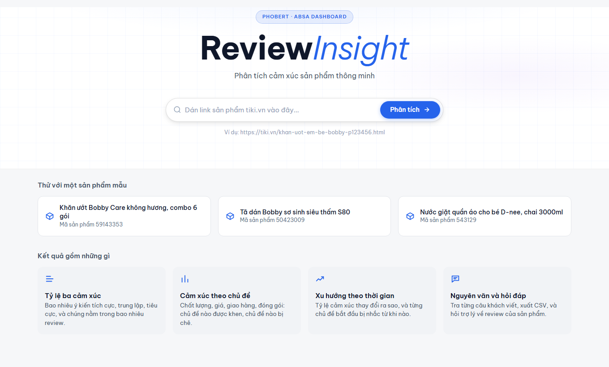
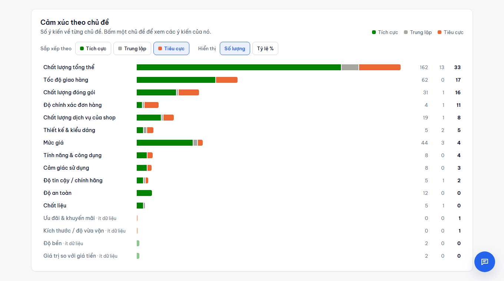
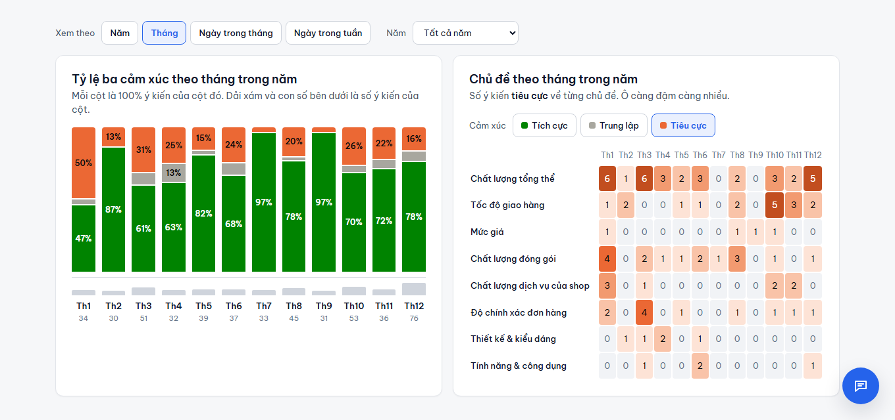
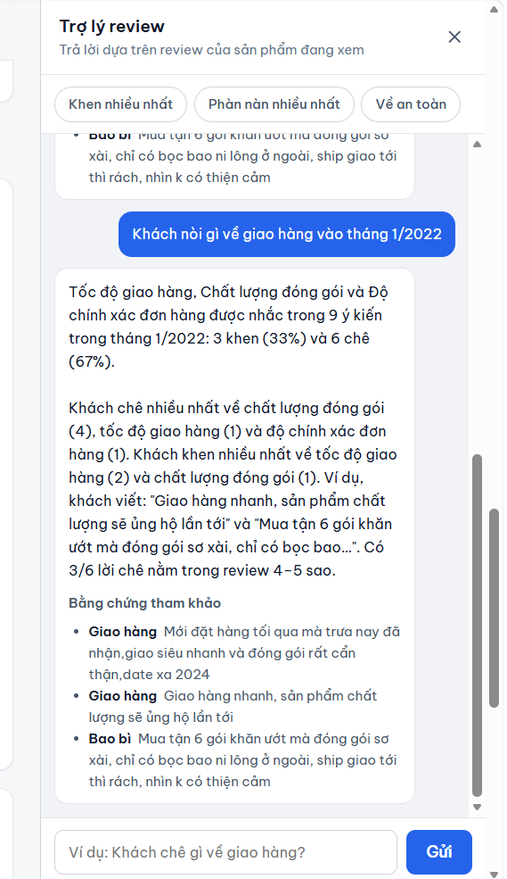

# ReviewInsight — Phân tích review khách hàng theo từng chủ đề


ReviewInsight biến hàng nghìn review tiếng Việt của một sản phẩm trên Tiki thành một bảng theo dõi cho **chủ cửa hàng**: khách đang **khen gì, chê gì**, chủ đề nào bị chê nhiều nhất, vấn đề xuất hiện từ khi nào, và khách đã viết nguyên văn những gì.



## Mục lục

1. [Bối cảnh](#1-bối-cảnh)
2. [Câu hỏi business](#2-câu-hỏi-business)
3. [Phương pháp](#3-phương-pháp)
   - 3.1 [Luồng xử lý](#31-luồng-xử-lý)
   - 3.2 [Mô hình](#32-mô-hình)
4. [Dashboard](#4-dashboard)
   - 4.1 [Tổng quan](#41-tổng-quan)
   - 4.2 [Cảm xúc theo chủ đề](#42-cảm-xúc-theo-chủ-đề)
   - 4.3 [Xu hướng theo thời gian](#43-xu-hướng-theo-thời-gian)
   - 4.4 [Khách nói gì](#44-khách-nói-gì)
   - 4.5 [Trợ lý review](#45-trợ-lý-review)
5. [Một ví dụ đọc kết quả](#5-một-ví-dụ-đọc-kết-quả)
6. [Công nghệ cốt lõi](#7-công-nghệ-cốt-lõi)
7. [Cấu trúc dự án](#8-cấu-trúc-dự-án)

---

## 1. Bối cảnh

Với nhóm sản phẩm mẹ và bé (tã, khăn ướt, sữa, đồ dùng cho bé), khách hàng đọc review rất kỹ vì sản phẩm dùng trực tiếp cho trẻ nhỏ. Người bán cũng cần review để biết mình đang làm tốt và chưa tốt ở đâu. Nhưng review khó khai thác:

- **Số lượng lớn.** Một sản phẩm bán chạy có hàng nghìn review. Sản phẩm minh họa trong dự án có 3.040 review.
- **Điểm sao che mất chi tiết.** Sao trung bình gần như luôn cao nên không giúp phân biệt sản phẩm, càng không cho biết *vấn đề nằm ở đâu*.
- **Một review nói nhiều chuyện.** Câu "tã thấm tốt nhưng giao hàng chậm, giá thì bình thường" vừa khen, vừa chê, vừa trung lập, về ba chủ đề khác nhau. Gán cho cả review một nhãn duy nhất làm mất thông tin.

Dự án giải quyết bằng cách **tách từng ý kiến trong review** (chủ đề nào, khen hay chê) rồi đếm, thay vì chấm điểm cả review.

## 2. Câu hỏi business

| # | Câu hỏi |
|---|---|
| 1 | Khách đang khen và chê ở mức nào? |
| 2 | Chủ đề nào bị chê nhiều nhất, tính theo số lượng và theo tỷ lệ? |
| 3 | Sao trung bình có phản ánh đúng trải nghiệm không? |
| 4 | Vấn đề đang tăng hay giảm, bắt đầu từ khi nào? |
| 5 | Có tính chu kỳ không (tháng cao điểm, cuối tháng, cuối tuần)? |
| 6 | Khách cụ thể nói gì, để làm việc với kho hoặc nhà cung cấp? |
| 7 | Có ai nhắc đến vấn đề an toàn hoặc hàng không chính hãng? |

## 3. Phương pháp

### 3.1 Luồng xử lý

```text
Link / mã sản phẩm 
        |
        v
Lấy thông tin sản phẩm + review 
        |
        v
Làm sạch văn bản, tách câu
        |
        v
PhoBERT: mỗi câu -> các bộ (khía cạnh, cảm xúc)
        |
        v
Dashboard + bảng ý kiến + trợ lý hỏi đáp
```

### 3.2 Mô hình

PhoBERT được tinh chỉnh để nhận diện khía cạnh và phân loại cảm xúc theo từng khía cạnh. Kết quả thực nghiệm ghi nhận của dự án, so với hai mô hình cơ sở:

| Mô hình | F1 nhận diện khía cạnh | F1 cảm xúc theo khía cạnh |
|---|---:|---:|
| **PhoBERT** (dùng trong ứng dụng) | 0,7975 | 0,8519 |
| BiLSTM-CRF | 0,7636 | 0,7951 |
| SVM + TF-IDF | 0,7735 | 0,8361 |

Trong ứng dụng, chỉ giữ dự đoán có độ tin cậy từ 0,6 trở lên, và chỉ xét các câu dài từ 15 đến 500 ký tự.

## 4. Dashboard

Ví dụ dưới đây dùng kết quả phân tích thật của sản phẩm *Combo 6 gói khăn ướt Bobby Care không hương*.

### 4.1 Tổng quan


Sáu thẻ chỉ số, đọc từ trái sang phải:

| Thẻ | Ý nghĩa |
|---|---|
| Review đã phân tích | Số review thực sự đưa vào phân tích, cùng tổng số review của sản phẩm |
| Tổng ý kiến | Tổng số ý kiến PhoBERT nhận ra, kèm số ý kiến trung bình mỗi review |
| Tích cực / Trung lập / Tiêu cực | Tỷ lệ ý kiến theo cảm xúc, số ý kiến, và số review chứa chúng. Con số mang màu của cảm xúc |
| Sao trung bình| Điểm sao của sản phẩm trên trang TMĐT |

### 4.2 Cảm xúc theo chủ đề



Mỗi chủ đề là một thanh chia ba đoạn (xanh lá, xám, cam). Có thể sắp xếp theo từng cảm xúc, chuyển giữa **số lượng** và **tỷ lệ %**, và bấm vào một chủ đề để xem các ý kiến của nó ở bảng bên dưới. Dùng **tỷ lệ** khi muốn so sánh các chủ đề có độ nhiều ý kiến khác nhau.

### 4.3 Xu hướng theo thời gian



Hàng nút "Xem theo" đổi cách gom thời gian cho cả hai biểu đồ.
- **Biểu đồ cột** mỗi cột là 100% ý kiến của khoảng thời gian đó. Hãy so độ dày từng đoạn màu giữa các cột. Dải xám bên dưới thể hiện số lượng ý kiến, và cột dưới 5 ý kiến bị làm mờ.
- **Bảng nhiệt** cho biết chủ đề nào tập trung vào khoảng thời gian nào, có bộ chọn để xem riêng cảm xúc tích cực, trung lập hoặc tiêu cực.

### 4.4 Khách nói gì


Mỗi dòng là một ý kiến, kèm chủ đề, cảm xúc, nguyên văn câu của khách, số sao và ngày. Có thể lọc theo cảm xúc, chủ đề, số sao, tìm theo từ khóa (từ khóa được tô nổi), và **xuất CSV** theo đúng bộ lọc đang chọn để chia sẻ với kho hoặc nhà cung cấp.

### 4.5 Trợ lý review



Nút tròn ở góc dưới bên phải mở khung hỏi đáp về chính sản phẩm đang xem, ví dụ "Khách chê gì về giao hàng?". Trợ lý trả lời dựa trên số liệu đã đếm và các câu review liên quan, có trích dẫn bằng chứng. 

## 5. Một ví dụ đọc kết quả

Sản phẩm *Combo 6 gói khăn ướt Bobby Care không hương* (3.040 review, sao trung bình 5,0). Hệ thống phân tích 197 review, nhận ra **497 ý kiến**: 369 tích cực (74%), 23 trung lập (5%), 105 tiêu cực (21%).

**1. Sao 5,0 nhưng vẫn có nhiều lời chê.** 67 trên 197 review (34%) chứa ít nhất một ý kiến tiêu cực, và **33 trong 67 review đó (49%) vẫn chấm 4 đến 5 sao**. Sao trung bình không nhìn thấy được những lời chê này.

**2. Chủ đề chiếm nhiều ý kiến nhất chưa chắc có tỷ lệ chê cao nhất.**

| Chủ đề | Số ý kiến | Tiêu cực | Tỷ lệ tiêu cực |
|---|---:|---:|---:|
| Chất lượng tổng thể | 208 | 33 | 15,9% |
| Tốc độ giao hàng | 79 | 17 | 21,5% |
| Chất lượng đóng gói | 48 | 16 | 33,3% |
| Chất lượng dịch vụ của shop | 28 | 8 | 28,6% |
| **Độ chính xác đơn hàng** | 16 | 11 | **68,8%** |
| Mức giá | 51 | 4 | 7,8% |
| Độ an toàn | 12 | 0 | 0% |

Chất lượng tổng thể có số lời chê tuyệt đối lớn nhất (33), nhưng **độ chính xác đơn hàng** mới là chủ đề mà khách chê nhiều nhất so với số lần được nhắc: 11 trên 16 ý kiến. Mở bảng ý kiến sẽ thấy đó là những trường hợp như "Mua loại 100 miếng, giao loại 80 miếng" hoặc "Mua gói 6 gói khăn mà giao chỉ có 5 bọc". Đây là lỗi vận hành (đóng nhầm hàng), không phải lỗi sản phẩm. Khách khen giá nhiều hơn chê (44 khen, 4 chê) và không có ý kiến tiêu cực nào về an toàn.

**3. Theo thời gian.** Tỷ lệ ý kiến tiêu cực là 22% năm 2021 (166 ý kiến) và 23% năm 2022 (249 ý kiến), giảm còn 14% năm 2023 (57 ý kiến). Các năm khác có quá ít ý kiến (13 ý kiến trở xuống) nên không nên kết luận.


## 6. Công nghệ cốt lõi

| Lớp | Công nghệ |
|---|---|
| Xử lý dữ liệu | Python, pandas, NumPy |
| Mô hình NLP | PhoBERT (PyTorch, Hugging Face Transformers) |
| Backend | FastAPI, Pydantic |
| Lưu trữ | PostgreSQL, thêm pgvector cho tìm kiếm ngữ nghĩa của trợ lý |
| Giao diện | Jinja2, HTML/CSS, JavaScript thuần |
| Trợ lý hỏi đáp | LLM Gemini (có thể thay bằng Groq) |

## 7. Cấu trúc dự án

```text
.
|-- app/
|   |-- api/              # Các route FastAPI và schema
|   |-- assistant/        # Trợ lý hỏi đáp
|   |-- core/             # Tác vụ phân tích chạy nền và gửi tiến độ
|   |-- web/              # Thu thập review, chạy PhoBERT, tổng hợp số liệu cho dashboard
|   |-- static/           # app.js, seller_dashboard.js và các file CSS
|   `-- templates/        # Trang HTML
|-- src/
|   |-- crawling/         # Thu thập sản phẩm và review 
|   |-- data_preprocessing/   # Làm sạch và chuẩn hóa văn bản
|   |-- annotation/       # Gán nhãn ý kiến bằng LLM
|   |-- data_labeling/    # Chuẩn bị mẫu gán nhãn thủ công và đối chiếu với LLM
|   `-- training/         # Huấn luyện PhoBERT, BiLSTM-CRF, SVM + TF-IDF
|-- data/                 # Dữ liệu 
|-- models/               # Tokenizer và cấu hình PhoBERT 
|-- docs/images/          # Ảnh minh họa giao diện
|-- Dockerfile
|-- docker-compose.yml
|-- pyproject.toml
|-- requirements.txt
`-- .env.example
```
