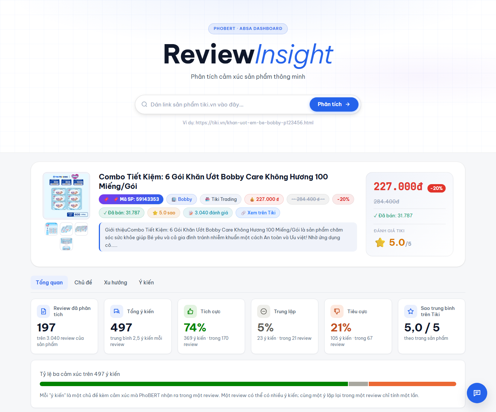
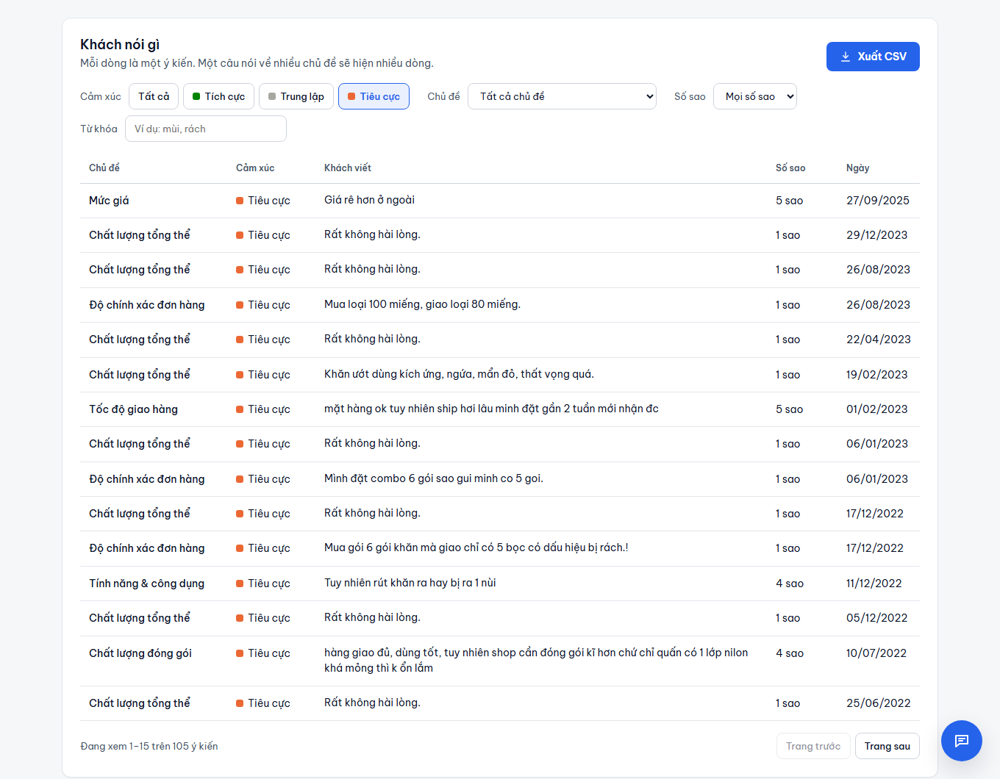
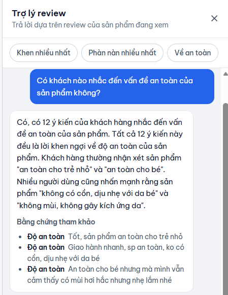
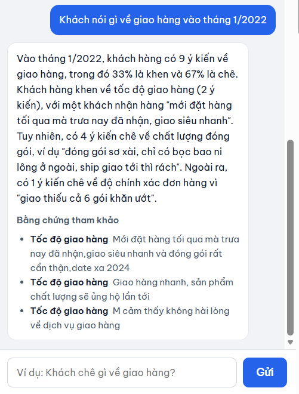
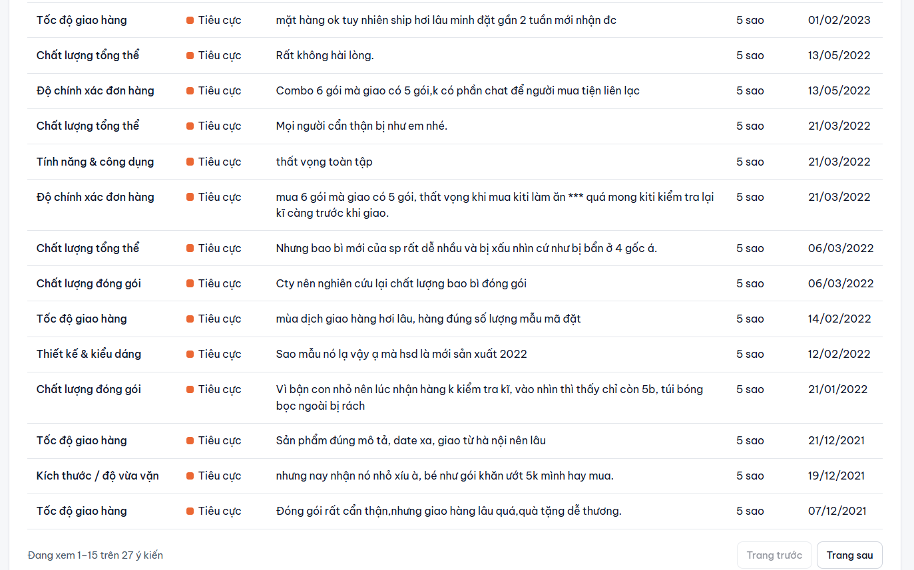

# ReviewInsight — Phân tích review khách hàng theo từng chủ đề


ReviewInsight biến hàng nghìn review tiếng Việt của một sản phẩm trên sàn TMĐT thành một bảng theo dõi cho **chủ cửa hàng**: khách đang **khen gì, chê gì**, chủ đề nào bị chê nhiều nhất, vấn đề xuất hiện từ khi nào, và khách đã viết nguyên văn những gì. Kèm theo là một **trợ lý hỏi đáp** trả lời bằng số liệu đếm từ database và trích dẫn review thật.


## Mục lục

1. [Bối cảnh](#1-bối-cảnh)
2. [Câu hỏi business](#2-câu-hỏi-business)
3. [Phương pháp](#3-phương-pháp)
   - 3.1 [Luồng xử lý](#31-luồng-xử-lý)
   - 3.2 [Mô hình phân tích cảm xúc theo khía cạnh](#32-mô-hình-phân-tích-cảm-xúc-theo-khía-cạnh)
   - 3.3 [Trợ lý hỏi đáp (RAG)](#33-trợ-lý-hỏi-đáp-rag)
4. [Dashboard](#4-dashboard)
5. [Một ví dụ đọc kết quả](#5-một-ví-dụ-đọc-kết-quả)
6. [Đánh giá trợ lý](#6-đánh-giá-trợ-lý)
7. [Công nghệ sử dụng](#7-công-nghệ-sử-dụng)
8. [Cấu trúc dự án](#8-cấu-trúc-dự-án)

---

## 1. Bối cảnh

Với nhóm sản phẩm mẹ và bé (tã, khăn ướt, sữa, đồ dùng cho bé), khách hàng đọc review rất kỹ vì sản phẩm dùng trực tiếp cho trẻ nhỏ. Người bán cũng cần review để biết mình đang làm tốt và chưa tốt ở đâu. Nhưng review khó khai thác:

- **Số lượng lớn.** Một sản phẩm bán chạy có hàng nghìn review. 
- **Điểm sao che mất chi tiết.** Sao trung bình gần như luôn cao nên không giúp phân biệt sản phẩm, càng không cho biết *vấn đề nằm ở đâu*.
- **Một review nói nhiều chuyện.** Câu "tã thấm tốt nhưng giao hàng chậm, giá thì bình thường" vừa khen, vừa chê, vừa trung lập, về ba chủ đề khác nhau. Gán cho cả review một nhãn duy nhất làm mất thông tin.

Dự án giải quyết bằng cách **tách từng ý kiến trong review** (chủ đề nào, khen hay chê) rồi đếm, thay vì chấm điểm cả review.

## 2. Câu hỏi business

| # | Câu hỏi |
|---|---|
| 1 | Khách đang khen và chê ở mức nào? |
| 2 | Chủ đề nào bị chê nhiều nhất, tính theo số lượng và theo tỷ lệ? |
| 3 | Sao trung bình có phản ánh đúng trải nghiệm không? |
| 4 | Vấn đề đang tăng hay giảm, bắt đầu từ khi nào? |
| 5 | Có tính chu kỳ không (tháng cao điểm, cuối tháng, cuối tuần)? |
| 6 | Khách cụ thể nói gì, để làm việc với kho hoặc nhà cung cấp? |
| 7 | Có ai nhắc đến vấn đề an toàn hoặc hàng không chính hãng? |

## 3. Phương pháp

### 3.1 Luồng xử lý

```text
Link / mã sản phẩm Tiki
        |
        v
Lấy thông tin sản phẩm + review
        |
        v
Làm sạch văn bản, tách câu
        |
        v
PhoBERT: mỗi câu -> các bộ (khía cạnh, cảm xúc, độ tin cậy)
        |
        v
Lưu PostgreSQL ---------------------> Dashboard 
        |
        v
Nhúng từng ý kiến bằng bge-m3, lưu pgvector
        |
        v
Trợ lý hỏi đáp 
```

### 3.2 Mô hình phân tích cảm xúc theo khía cạnh

PhoBERT để nhận diện khía cạnh và phân loại cảm xúc (khen / trung lập / chê) theo từng khía cạnh, trên **17 chủ đề** thuộc 4 nhóm:

| Nhóm | Chủ đề |
|---|---|
| Sản phẩm | Chất lượng tổng thể, Chất liệu, Cảm giác sử dụng, Tính năng & công dụng, Kích thước, Độ bền, Thiết kế, Độ an toàn, Giá trị so với giá tiền |
| Giá | Mức giá, Ưu đãi & khuyến mãi |
| Giao hàng | Tốc độ giao hàng, Chất lượng đóng gói, Độ chính xác đơn hàng |
| Người bán | Chất lượng dịch vụ, Mức độ phản hồi, Độ tin cậy / chính hãng |

Dữ liệu huấn luyện được gán nhãn bằng LLM rồi đối chiếu với một mẫu gán nhãn thủ công. Kết quả so với hai mô hình cơ sở:

| Mô hình | F1 nhận diện khía cạnh | F1 cảm xúc theo khía cạnh |
|---|---:|---:|
| **PhoBERT** (dùng trong ứng dụng) | 0,7975 | 0,8519 |
| BiLSTM-CRF | 0,7636 | 0,7951 |
| SVM + TF-IDF | 0,7735 | 0,8361 |


### 3.3 Trợ lý hỏi đáp (RAG)

```text
Câu hỏi
  |
  v
[1] Phân tích câu hỏi 
  |
  v
[2] Số liệu: đếm ý kiến đúng phạm vi 
  |
  v
[3] Tìm bằng chứng (hybrid retrieval)
    - tìm theo nghĩa trong pgvector (embedding BAAI/bge-m3), lọc theo chủ đề/cảm xúc/ngày
    - xếp hạng lại bằng cross-encoder BAAI/bge-reranker-v2-m3
  |
  v
[4] Không có dữ liệu trong phạm vi -> trả lời "không có ý kiến" 
  |
  v
[5] Viết câu trả lời: Gemini viết từ số liệu + bằng chứng.

```

Kết quả tìm kiếm được lưu đệm trong Redis 

## 4. Dashboard

Ví dụ dưới đây dùng kết quả phân tích thật của sản phẩm *Combo 6 gói khăn ướt Bobby Care không hương*. Dashboard là một trang dài, thanh điều hướng **Tổng quan · Chủ đề · Xu hướng · Ý kiến** nhảy tới từng phần (mục 4.1 đến 4.4). Trợ lý hỏi đáp (mục 4.5) mở được từ bất kỳ đâu qua nút tròn ở góc dưới bên phải.

### 4.1 Tổng quan



Đầu trang là thông tin sản phẩm lấy từ Tiki: tên, mã sản phẩm, thương hiệu, người bán, giá và mức giảm, số đã bán, số đánh giá. Bên dưới là sáu thẻ chỉ số, đọc từ trái sang phải:

| Thẻ | Ý nghĩa |
|---|---|
| Review đã phân tích | Số review thực sự đưa vào phân tích, trên tổng số review của sản phẩm (Các review không có nội dung sẽ bị loại)|
| Tổng ý kiến | Tổng số ý kiến model nhận ra, kèm số ý kiến trung bình mỗi review |
| Tích cực / Trung lập / Tiêu cực | Tỷ lệ ý kiến theo cảm xúc, số ý kiến và số review chứa chúng |
| Sao trung bình trên Tiki | Điểm sao của sản phẩm theo trang sản phẩm |

Thanh ngang cuối phần này cho thấy tỷ lệ ba cảm xúc trên toàn bộ ý kiến. Một "ý kiến" là một chủ đề kèm cảm xúc mà Model nhận ra trong một review. Một review có thể có nhiều ý kiến.

### 4.2 Cảm xúc theo chủ đề


Mỗi chủ đề là một thanh chia ba đoạn (xanh lá: tích cực, xám: trung lập, cam: tiêu cực). Ba cột số bên phải là số ý kiến của từng cảm xúc.
- **Sắp xếp theo** một cảm xúc. Cột số của cảm xúc đó được in đậm; ảnh trên đang sắp theo số lời chê.
- **Hiển thị** theo số lượng hoặc tỷ lệ %. Dùng tỷ lệ khi so các chủ đề có số ý kiến chênh nhau nhiều.
- Chủ đề có dưới 5 ý kiến bị làm mờ, gắn nhãn "ít dữ liệu" và xếp xuống cuối.

### 4.3 Xu hướng theo thời gian


Hàng nút **Xem theo** (năm, tháng, ngày trong tháng, ngày trong tuần) và ô chọn **Năm** đổi cách gom thời gian cho cả hai biểu đồ. Cách gom theo tháng, ngày trong tháng và ngày trong tuần dùng để tìm tính chu kỳ (câu hỏi 5).
- **Biểu đồ cột:** mỗi cột là 100% ý kiến của khoảng thời gian đó, nên hãy so độ dày từng đoạn màu giữa các cột. Dải xám và con số bên dưới là số ý kiến của cột; cột dưới 5 ý kiến bị làm mờ.
- **Bảng nhiệt:** chủ đề ý kiến theo từng khoảng thời gian, ô càng đậm càng nhiều. Bộ chọn **Cảm xúc** đổi giữa tích cực, trung lập và tiêu cực.

Trong ảnh, khi gộp mọi năm theo tháng, tháng 1 có tỷ lệ tiêu cực cao nhất (50% trên 34 ý kiến), chủ yếu do chất lượng tổng thể và chất lượng đóng gói.

### 4.4 Khách nói gì



Mỗi dòng là một ý kiến, kèm chủ đề, cảm xúc, nguyên văn câu của khách, số sao và ngày. Một câu nói về nhiều chủ đề sẽ hiện thành nhiều dòng. Có thể lọc theo cảm xúc, chủ đề, số sao, tìm theo từ khóa (từ khóa được tô nổi), và **xuất CSV** theo đúng bộ lọc đang chọn để chia sẻ với kho hoặc nhà cung cấp. 

### 4.5 Trợ lý review

Nút tròn ở góc dưới bên phải mở khung hỏi đáp về chính sản phẩm đang xem. Mỗi câu trả lời gồm hai phần: đoạn trả lời có số liệu đếm từ database, và mục **Bằng chứng tham khảo** liệt kê tối đa 3 câu review gốc kèm chủ đề của chúng (cách hoạt động ở [mục 3.3](#33-trợ-lý-hỏi-đáp-rag)).

<table>
  <tr>
    <td width="50%" valign="top"></td>
    <td width="50%" valign="top"></td>
  </tr>
  <tr>
    <td valign="top"><b>Câu hỏi gợi ý.</b> Ba nút <i>Khen nhiều nhất</i>, <i>Phàn nàn nhiều nhất</i>, <i>Về an toàn</i> điền sẵn các câu hỏi thường gặp. Với câu hỏi về an toàn, trợ lý đếm được 12 ý kiến và cả 12 đều là lời khen, khớp với dòng <i>Độ an toàn</i> ở mục 4.2 (12 tích cực, 0 tiêu cực).</td>
    <td valign="top"><b>Câu hỏi có mốc thời gian.</b> Trợ lý chỉ đếm ý kiến trong tháng 1/2022: 9 ý kiến về giao hàng, 33% khen và 67% chê. "Giao hàng" được hiểu là cả nhóm chủ đề (tốc độ giao hàng, chất lượng đóng gói, độ chính xác đơn hàng), và mỗi ý đều kèm câu nguyên văn của khách.</td>
  </tr>
</table>


## 5. Một ví dụ đọc kết quả

Sản phẩm *Combo 6 gói khăn ướt Bobby Care không hương* (3.040 review, sao trung bình 5,0). Hệ thống phân tích 197 review, nhận ra **497 ý kiến**: 369 tích cực (74%), 23 trung lập (5%), 105 tiêu cực (21%).

**1. Sao 5,0 nhưng vẫn có nhiều lời chê.** 67 trên 197 review chứa ít nhất một ý kiến tiêu cực. Sao trung bình không nhìn thấy được những lời chê này.


**2. Chủ đề chiếm nhiều ý kiến nhất chưa chắc có tỷ lệ chê cao nhất.**

| Chủ đề | Số ý kiến | Tiêu cực | Tỷ lệ tiêu cực |
|---|---:|---:|---:|
| Chất lượng tổng thể | 208 | 33 | 15,9% |
| Tốc độ giao hàng | 79 | 17 | 21,5% |
| Chất lượng đóng gói | 48 | 16 | 33,3% |
| Chất lượng dịch vụ của shop | 28 | 8 | 28,6% |
| **Độ chính xác đơn hàng** | 16 | 11 | **68,8%** |
| Mức giá | 51 | 4 | 7,8% |
| Độ an toàn | 12 | 0 | 0% |

Chất lượng tổng thể có số lời chê tuyệt đối lớn nhất (33), nhưng **độ chính xác đơn hàng** mới là chủ đề mà khách chê nhiều nhất so với số lần được nhắc: 11 trên 16 ý kiến. Mở bảng ý kiến sẽ thấy đó là những trường hợp như "Mua loại 100 miếng, giao loại 80 miếng" hoặc "Mua gói 6 gói khăn mà giao chỉ có 5 bọc". Đây là lỗi vận hành (đóng nhầm hàng), không phải lỗi sản phẩm. Khách khen giá nhiều hơn chê (44 khen, 4 chê) và không có ý kiến tiêu cực nào về an toàn.

**3. Theo thời gian.** Tỷ lệ ý kiến tiêu cực là 22% năm 2021 (166 ý kiến) và 23% năm 2022 (249 ý kiến), giảm còn 14% năm 2023 (57 ý kiến).

## 6. Đánh giá trợ lý

Trợ lý được đánh giá bằng [Ragas](https://docs.ragas.io)


### 6.1 Metric

| Metric | Đo gì | Cách tính |
|---|---|---|
| **Context Precision** | Bằng chứng lấy về có đúng không | Tỷ lệ bằng chứng nằm trong đáp án  |
| **Context Recall** | Có lấy đủ bằng chứng không | Số review đáp án lấy được / min(6, số review đáp án). Chia cho min(6, ...) vì chat chỉ trả tối đa 6 bằng chứng |
| **Faithfulness** | Câu trả lời có bịa không | Giám khảo LLM tách câu trả lời thành từng ý và kiểm tra mỗi ý có dựa trên số liệu/bằng chứng không |
| **Answer Relevancy** | Câu trả lời có đúng trọng tâm không | Giám khảo LLM sinh ngược câu hỏi từ câu trả lời, rồi so độ tương đồng với câu hỏi gốc |

### 6.2 Kết quả

Chatbot dùng `gemini-3.1-flash-lite`, giám khảo là `gpt-4.1-mini`.

| Metric | Điểm | 
|---|---:|
| Context Precision | **1,000** | 
| Context Recall | **0,954** |
| Faithfulness | **0,913** |
| Answer Relevancy | **0,653** | 


Một số điểm đáng chú ý:
- **Bằng chứng luôn đúng phạm vi câu hỏi:** Precision đạt 1,0, kể cả với câu hỏi theo thời gian mơ hồ hoặc tương đối. Với câu không có dữ liệu, trợ lý trả lời đúng là "không có ý kiến" chứ không bịa ra ý kiến.
- **Faithfulness 0,91:** đôi khi câu trả lời diễn giải rộng hơn nội dung bằng chứng, ví dụ nêu thêm một chủ đề mà không có trích dẫn đi kèm.


### 6.3 Hạn chế đã biết

- **Answer Relevancy thấp phần lớn do cách đo.** Metric này chấm bằng cách Giám khảo (gpt-4.1-mini) chỉ đọc câu trả lời và đoán xem "câu trả lời này là để trả lời câu hỏi nào?". Nó viết ra 3 câu hỏi đoán. Một model nhỏ là MiniLM chuyển câu hỏi gốc và 3 câu đoán thành vector số. Điểm là mức độ giống nhau giữa câu hỏi gốc và các câu đoán, lấy trung bình.


## 7. Công nghệ sử dụng

| Lớp | Công nghệ |
|---|---|
| Thu thập dữ liệu | `requests` (API công khai của Tiki), BeautifulSoup |
| Xử lý dữ liệu | Python, pandas, NumPy, underthesea (tách câu) |
| Mô hình ABSA | PhoBERT (PyTorch, Hugging Face Transformers). So sánh với BiLSTM-CRF và SVM + TF-IDF (scikit-learn) |
| Gán nhãn dữ liệu | LLM tự gán nhãn, Label Studio để gán nhãn thủ công 200 mẫu và đánh giá kết quả của LLM |
| Backend | FastAPI, Uvicorn, Pydantic, SQLAlchemy |
| Lưu trữ | PostgreSQL 16 + pgvector, Redis (bộ nhớ đệm) |
| Tìm kiếm ngữ nghĩa | sentence-transformers: embedding `BAAI/bge-m3` , cross-encoder `BAAI/bge-reranker-v2-m3`  |
| LLM của trợ lý | Google Gemini (mặc định `gemini-2.5-flash`) |
| Giao diện | Jinja2, HTML/CSS, JavaScript |
| Đánh giá | Ragas 0.4, giám khảo OpenAI `gpt-4.1-mini` |
| Triển khai | Docker Compose (api + pgvector/pgvector:pg16 + redis), hoặc chạy trực tiếp trên Windows |

## 8. Cấu trúc dự án

```text
.
|-- app/
|   |-- api/                  # Các route FastAPI và schema
|   |-- assistant/            # Trợ lý hỏi đáp (RAG)
|   |-- core/                 # Tác vụ phân tích chạy nền và gửi tiến độ
|   |-- web/                  # Thu thập review, chạy PhoBERT, tổng hợp số liệu cho dashboard
|   |-- static/               # app.js, seller_dashboard.js và các file CSS
|   `-- templates/            # Trang HTML
|-- src/
|   |-- crawling/             # Thu thập sản phẩm và review
|   |-- data_preprocessing/   # Làm sạch và chuẩn hóa văn bản
|   |-- annotation/           # Gán nhãn ý kiến bằng LLM
|   |-- data_labeling/        # Chuẩn bị mẫu gán nhãn thủ công và đối chiếu với LLM
|   |-- training/             # Huấn luyện PhoBERT, BiLSTM-CRF, SVM + TF-IDF
|   `-- evaluation/           # Sinh câu hỏi, gán đáp án, đánh giá Ragas và bộ lọc
|-- scripts/                  # Cài database, nạp dữ liệu, nhúng lại vector, hỏi trợ lý từ dòng lệnh
|-- data/                     # Dữ liệu
|-- models/                  
|-- docs/images/              # Ảnh minh họa giao diện
|-- run_local.ps1             # Chạy trên Windows không cần Docker
|-- Dockerfile
|-- docker-compose.yml
|-- pyproject.toml
`-- requirements.txt
```
